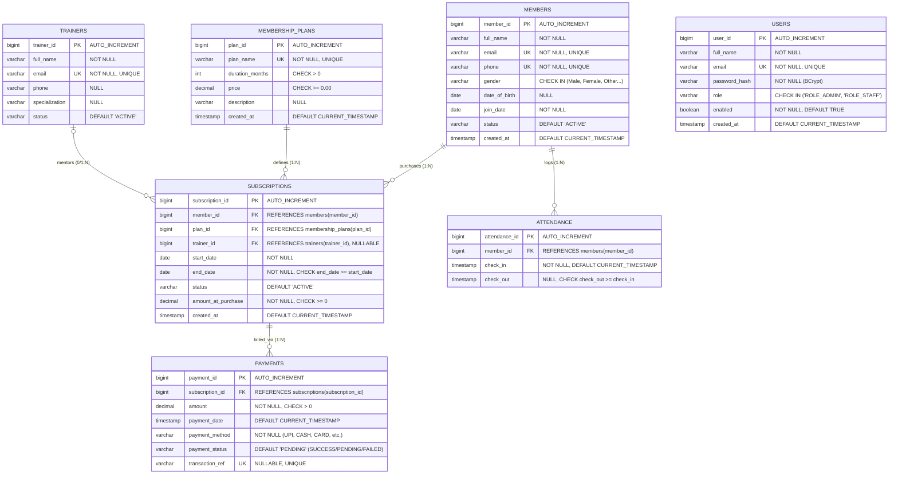

# GymSphere — Entity Relationship (ER) Diagram & Relational Model

## 1. Relational Database Overview

GymSphere's database (`gymsphere_db`) is designed in **Third Normal Form (3NF)** / **Boyce-Codd Normal Form (BCNF)** to eliminate data anomalies, redundancy, and maintain strict referential integrity.

### Core Tables & Purposes
1. **`members`**: Gym customer profiles (demographics, contact, active status).
2. **`trainers`**: Certified instructors with fitness specializations.
3. **`membership_plans`**: Membership catalog definitions (duration in months, current standard price).
4. **`subscriptions`**: Junction table resolving the Many-to-Many relationship between `members` and `membership_plans`. Contains purchase-time price snapshot (`amount_at_purchase`) and optional `trainer_id`.
5. **`payments`**: Financial transaction ledger recording payments made against a subscription (status: SUCCESS, PENDING, FAILED).
6. **`attendance`**: Daily check-in/check-out logs linked to a member.
7. **`users`**: Administrative and staff credentials for system security and role-based access control (RBAC). Kept separate from gym members.

---

## 2. Mermaid Entity Relationship (ER) Diagram

---

## 3. Detailed Relationship Explanations

### A. `members` to `subscriptions` (1 : N)
- **Cardinality**: One member can have zero, one, or multiple subscriptions over time (e.g., historical renewals or separate concurrent offerings).
- **Foreign Key**: `subscriptions.member_id` references `members.member_id`.
- **Integrity Rule**: `ON DELETE RESTRICT`, `ON UPDATE CASCADE`. Prevents accidental deletion of member records who have active or historical subscriptions.

### B. `membership_plans` to `subscriptions` (1 : N)
- **Cardinality**: One membership plan can be purchased by multiple members across multiple subscriptions.
- **Foreign Key**: `subscriptions.plan_id` references `membership_plans.plan_id`.
- **Integrity Rule**: `ON DELETE RESTRICT`. Ensures an active plan catalog cannot be deleted while subscriptions depend on it.

### C. `trainers` to `subscriptions` (0/1 : N)
- **Cardinality**: Personal trainer assignment is optional. A subscription may have `trainer_id = NULL` for general gym admission, or refer to a specific trainer. One trainer can have multiple client subscriptions.
- **Foreign Key**: `subscriptions.trainer_id` references `trainers.trainer_id`.
- **Integrity Rule**: `ON DELETE SET NULL`, `ON UPDATE CASCADE`. If a trainer leaves the gym, existing subscriptions preserve their validity with `trainer_id` reset to NULL.

### D. `subscriptions` to `payments` (1 : N)
- **Cardinality**: A single subscription can have one or more payment attempts (e.g. initial failed transaction followed by successful payment, or split installments).
- **Foreign Key**: `payments.subscription_id` references `subscriptions.subscription_id`.
- **Integrity Rule**: `ON DELETE RESTRICT`. Preserves financial accounting and auditing history.

### E. `members` to `attendance` (1 : N)
- **Cardinality**: One gym member has multiple daily attendance records over time.
- **Foreign Key**: `attendance.member_id` references `members.member_id`.
- **Integrity Rule**: `ON DELETE CASCADE`. Attendance is an operational access log directly tied to the physical member.

### F. `users` (Standalone Security Domain)
- `users` is intentionally **decoupled** from `members`. In enterprise DBMS design, administrative staff and operational operators must not be conflated with customer accounts. This adheres to the Principle of Least Privilege and separation of concerns.

---

## 4. Normalization Analysis (DBMS Viva Focus)

1. **First Normal Form (1NF)**:
   - All attributes are atomic (no multi-valued attributes or repeating groups).
   - Each table has a defined primary key (`member_id`, `trainer_id`, `plan_id`, etc.).

2. **Second Normal Form (2NF)**:
   - The schema is in 1NF.
   - All non-key attributes are fully functionally dependent on the primary key (no partial dependencies on composite keys).

3. **Third Normal Form (3NF)**:
   - The schema is in 2NF.
   - No transitive dependencies exist (non-prime attributes do not depend on other non-prime attributes).
   - Example: We do not store `plan_duration` in `subscriptions`; it is retrieved dynamically via `plan_id`. We explicitly store `amount_at_purchase` in `subscriptions` because that is a **historical snapshot at the exact moment of sale**, not a transitive dependency.
